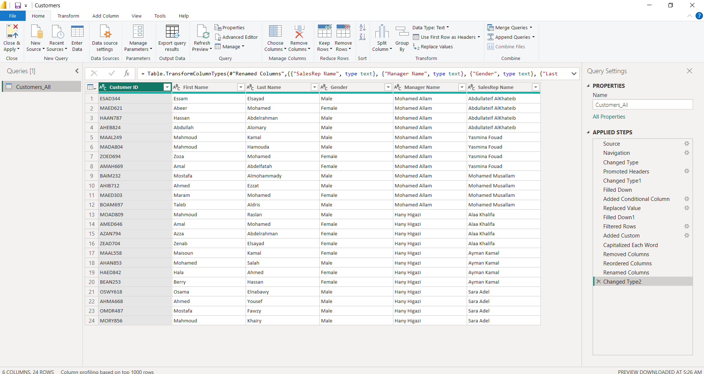
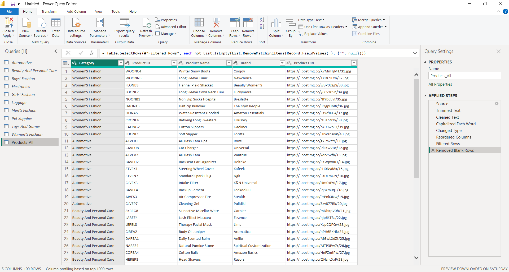
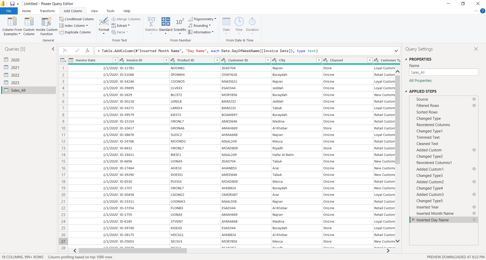
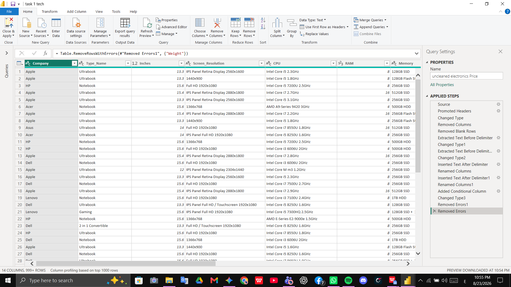

# Advanced Enterprise Data Cleaning & Wrangling System

**Role & Execution:** Data Cleaning & Data Quality Analyst.

- **System Scope:** Designed and executed an end-to-end data cleaning pipeline for complex, unstructured enterprise datasets.
- **Technical Implementation:** Performed an end-to-end data cleaning and wrangling process by handling missing values, eliminating duplicates, standardizing mismatched data types, resolving outlier anomalies, and ensuring data integrity for downstream analysis.
- **Tech Stack:** Power Query, Data Cleaning, ETL Pipeline Architecture, Data Quality Assurance.

## 🖼️ Project Preview

